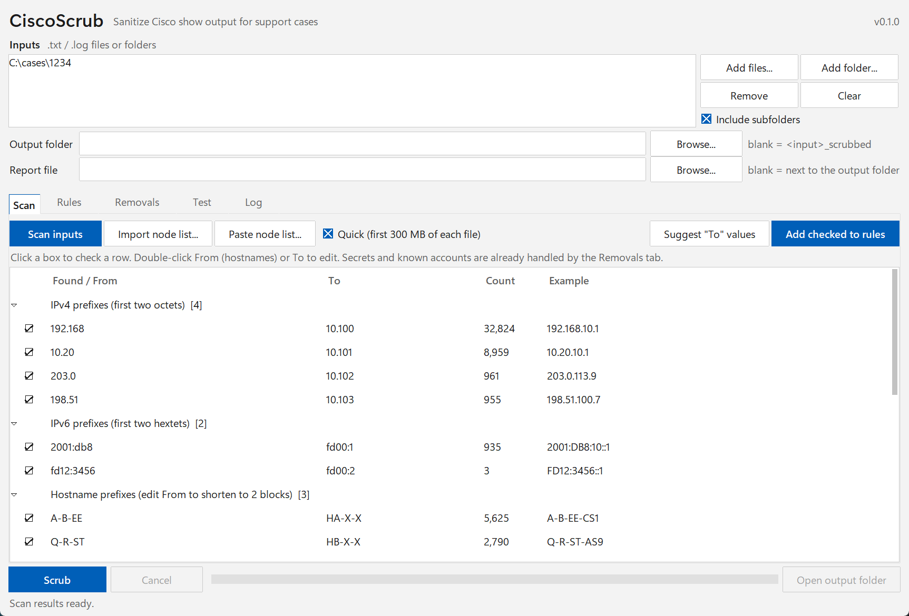
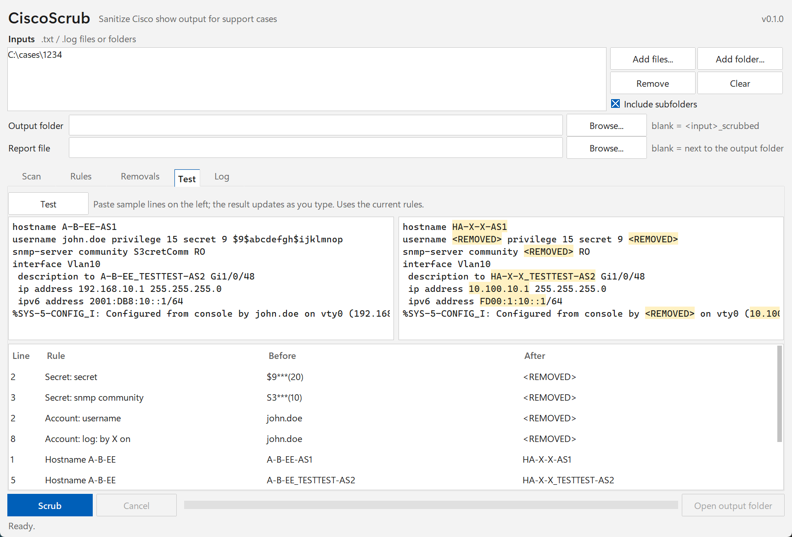

# CiscoScrub

Sanitize Cisco show-command output before attaching it to a vendor support case.

CiscoScrub reads `.txt` / `.log` files, including multi-GB `show tech-support` output, and writes scrubbed copies:

- **Remaps** IP prefixes and hostnames, so the network still makes sense to support but is not yours
  (`192.168.10.1` → `10.100.10.1`, `A-B-EE-AS1` → `HA-X-X-AS1`).
- **Removes** passwords, secrets, keys, SNMP communities and account names (→ `<REMOVED>`).
- Writes a **CSV report** of every change: file, rule, before, after, count and first line number.

It is one Python file that uses only the standard library: no installs, no internet, nothing leaves the PC.



## Requirements

- Windows, macOS or Linux with **Python 3.6 or newer**.
- tkinter for the GUI. It is included with the python.org Windows installer; check with `python -c "import tkinter"`.
  Without it, the command line still works.

## Quick start

1. Run `python ciscoscrub.py` to open the GUI.
2. **Add files...** or **Add folder...** (subfolders are included by default).
3. On the **Scan** tab, click **Scan inputs**. CiscoScrub lists what it found: IPv4 and IPv6 prefixes, hostname
   prefixes, domains, possible account names, SNMP location / contact, and lines with password or key words that
   no rule covers yet.
4. Click **Suggest "To" values** (or double-click a To cell to type your own), check what you want, and click
   **Add checked to rules**. Rules are saved to `scrub_rules.json` next to the script, so this is a one-time setup.
5. Optional: on the **Test** tab, paste a few lines and see the scrubbed result as you type.
6. Click **Scrub**. The output goes to `<input>_scrubbed\`. Each file gets a `_scrubbed` suffix, and line numbers
   are unchanged.



> **The report contains the original values.** It is written next to the output folder, never inside it.
> Send the `_scrubbed` folder, not the report.

## What gets scrubbed

| | How |
|---|---|
| **IPv4** | First two octets remapped per rule (`192.168` → `10.100`). Masks, multicast, version strings and SNMP OIDs are left alone. |
| **IPv6** | First two hextets remapped per rule (`2001:db8` → `fd00:1`). Handles compressed forms, leading zeros, upper case, `/len` and `%zone`. |
| **Hostnames** | Leading blocks remapped (`A-B-EE` → `HA-X-X`); the rest of the name is kept. Matches FQDNs, CDP/LLDP neighbors and descriptions, in any case. An optional role rule remaps the last block (`AS1` → `SW1`). |
| **Secrets** | Built-in rules for `password`, `secret`, `key-string`, `enable`, SNMP communities and v3 keys, TACACS / RADIUS keys, ISAKMP / IKEv2 pre-shared keys, OSPF / BGP / NTP / HSRP authentication, WPA PSK and more. The encryption type is kept (`secret 9 <REMOVED>`). Each rule can be switched off. |
| **Accounts** | Removed in config (`username`, `snmp-server user`) and in logs (`by X on vty0`, `[user: X]`, `User:X`, accounting logs). A first pass learns every name found and then removes it everywhere. |
| **Domains / text** | Replace-text rules (whole word, any case). |
| **Custom** | "Remove the value after keyword X" (next word or rest of line), or an advanced regex. |

**Account lists.** On the Removals tab you can add accounts by hand. An entry ending in `.` or `*` is a prefix:
`adm.` removes every `adm.<name>`, and `adm*` removes anything that starts with `adm`.

**Node lists.** On the Scan tab, **Import node list...** reads an Excel `.xlsx`, CSV or text file (any sheet,
any column), and **Paste node list...** takes a column pasted from Excel. The hostname prefixes then show up as
suggestions.

## The report

One CSV per run. By default each unique value appears once per file, with a count and its first line number:

| File | Rule | Before | After | Count | First line |
|---|---|---|---|---|---|
| sh_tech.txt | IPv4 192.168 | 192.168.10.1 | 10.100.10.1 | 214 | 3542 |
| sh_tech.txt | Secret: snmp community | S3\*\*\*(10) | \<REMOVED\> | 2 | 61 |

- Secrets are masked in the report by default.
- A setting writes every occurrence instead.
- The report also flags things worth a look:
  - **Residual**: a remapped prefix still appears in an unusual form.
  - **Collision**: a "to" prefix already exists in the input, which would make the output ambiguous.
  - **Possible account**: a `word.word` name that was not removed.
  - **Residual hostname**: a hostname-shaped name whose prefix has no rule.

## Large files and speed

- Files are streamed in 4 MB chunks, so memory use stays small whatever the file size. Every byte and line
  ending is kept as it was.
- Typical speed is 25–35 MB/s per file, so a 6 GB show tech takes about 4 minutes.
- Several files can be scrubbed in parallel, at most 3 at once and at below-normal priority, so shared hosts
  stay responsive.
- The run keeps going when the window is minimized, and the PC is kept awake until it finishes.
- **Cancel** removes partial output.

## Command line

```
python ciscoscrub.py INPUT [INPUT ...] [-o OUTPUT_DIR] [-r REPORT.csv] [--rules FILE] [--no-learn] [--detail]
```

This uses the same rules file as the GUI. For example, `python ciscoscrub.py C:\cases\1234` writes
`C:\cases\1234_scrubbed\` and `C:\cases\1234_scrub_report_<time>.csv`.

## Files

| File | |
|---|---|
| `ciscoscrub.py` | the whole program |
| `scrub_rules.json` | your rules and settings, created on first run. It holds your real prefixes and hostnames, so keep it out of version control (`.gitignore` does). |

## Limits

- No undo. Keep the originals.
- Only text output: `.gz` / `.zip` files must be extracted first.
- IP addresses in unusual forms (hex in debug output, `ip-10-20-1-1` style names) are not remapped. Check the
  report's Residual rows.
- Remapped values can change string length, so column alignment in tables can shift.
